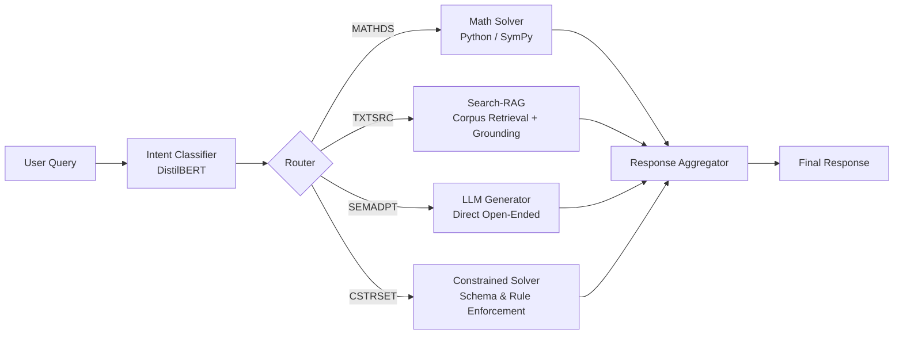

# User Intent Classification for Hallucination Reduction in LLMs

A research implementation studying the **cost-accuracy tradeoff** of lightweight small language models (SLM) for front-end query routing vs. direct zero-shot large language model (LLM) execution.

---

## 1. System Architecture



---

## 2. Intent Taxonomy (4 Classes)

| Class | Full Name | Query Characteristics | Downstream Handler | Hallucination Addressed |
| :--- | :--- | :--- | :--- | :--- |
| **`MATHDS`** | Math & Data Science | Arithmetic, algebraic, statistical, or numerical calculations | Deterministic Python / SymPy execution | Prevents arithmetic/calculation hallucination |
| **`TXTSRC`** | Text Search | Factual lookups, current events, entity queries, knowledge retrieval | Dense/sparse retrieval + Grounded generation | Prevents factual/temporal knowledge fabrication |
| **`SEMADPT`** | Semantic Adaptation | Creative writing, stylistic transformation, brainstorming, summarizing | Direct ungrounded LLM generation | Eliminates unnecessary retrieval latency/cost |
| **`CSTRSET`** | Constraint Satisfaction | Format-specific (JSON/XML), length, negative constraints, rule systems | Grammar-guided or schema-validated LLM | Prevents format violation and rule drift |

---

## 3. Comparative Evaluation Framework

Under identical conditions and an identical **10% held-out test split**:
1. **Fine-Tuned DistilBERT Classifier (~66M parameters)**:
   - WordPiece Tokenizer → DistilBERT [CLS] → Linear Classification Head (4 classes).
   - Fast, local CPU/GPU execution, zero per-query API cost.
2. **Zero-Shot LLM Baseline (e.g., GPT-3.5-turbo / 7B-175B parameters)**:
   - Zero-shot prompt with class taxonomy and format instructions.
   - High parameter scale, token billing per query, network latency.

### Required Metrics
- **Overall Accuracy**
- **Per-Class Precision, Recall, and F1-score** (MATHDS, TXTSRC, SEMADPT, CSTRSET)
- **Confusion Matrix** (Normalized & Raw)
- **Inference Latency** (Mean, P50, P95 in ms/query)
- **Token and API Cost** ($ / 1,000 queries)
- **Tradeoff Score**: $\Delta \text{Accuracy} \times \Delta \text{Cost}$

---

## 4. Directory Structure and File Descriptions

```
nndl proj/
├── configs/
│   ├── config.yaml               # Pipeline hyperparameters, model configs, paths, and split ratios
│   └── label_map.json            # Bidirectional mapping between class IDs and labels
├── data/
│   ├── raw/                      # Raw dataset inputs across the 4 intent categories
│   ├── processed/                # Stratified 80% train, 10% validation, 10% test splits (.jsonl)
│   ├── __init__.py
│   └── dataset_loader.py         # Data preprocessing, split generation, and PyTorch DataLoader creation
├── models/
│   ├── __init__.py
│   ├── distilbert_classifier.py  # DistilBERT model wrapper, forward pass, and inference engine
│   └── zero_shot_llm.py          # Zero-shot LLM baseline client, prompt builder, and token/cost tracker
├── training/
│   ├── __init__.py
│   └── train_classifier.py       # Fine-tuning loop with AdamW, validation monitoring, and checkpoint saving
├── evaluation/
│   ├── __init__.py
│   ├── metrics.py                # Accuracy, per-class P/R/F1, latency stats, and cost calculations
│   ├── evaluate_all.py           # Orchestrator evaluating DistilBERT vs Zero-Shot LLM on test set
│   └── plot_confusion_matrix.py  # Publication-grade confusion matrix and cost-accuracy tradeoff plots
├── router/
│   ├── __init__.py
│   ├── query_router.py           # Main query dispatcher mapping predicted intent to handlers
│   ├── aggregator.py             # Response aggregator assembling output, confidence, and latency
│   └── handlers/
│       ├── __init__.py
│       ├── math_solver.py        # MATHDS: Safe Python/SymPy calculation handler
│       ├── rag_search.py         # TXTSRC: Search/RAG factual lookup handler
│       ├── llm_generator.py      # SEMADPT: Direct LLM open-ended generation handler
│       └── constrained_solver.py # CSTRSET: Schema and constraint validation handler
├── artifacts/
│   ├── checkpoints/              # Best validation model weights
│   ├── figures/                  # Confusion matrix heatmaps and tradeoff charts
│   └── reports/                  # Benchmark results, comparison markdown, and JSON summaries
├── docs/
│   ├── Review-2-NNDL.pdf         # Review 2 Presentation Slide deck (Literature Review & Architecture)
│   └── Review2_UserIntent_LLM.pptx
├── requirements.txt              # Project package dependencies
└── README.md                     # Project documentation and architectural overview
```

---

## 5. Minimal Implementation Plan

1. **Phase 1: Dataset Assembly & Split Preparation (80/10/10)**
   - Collect and balance samples for `MATHDS`, `TXTSRC`, `SEMADPT`, `CSTRSET`.
   - Implement `data/dataset_loader.py` to stratify and export `train.jsonl`, `val.jsonl`, and `test.jsonl`.
2. **Phase 2: DistilBERT Fine-Tuning**
   - Implement `models/distilbert_classifier.py` and `training/train_classifier.py`.
   - Train for ~3-5 epochs, tracking validation loss/accuracy and saving best checkpoint in `artifacts/checkpoints/`.
3. **Phase 3: Zero-Shot LLM Baseline Setup**
   - Implement `models/zero_shot_llm.py` with structured prompt and token-cost measurement.
4. **Phase 4: Comparative Benchmarking & Visualization**
   - Implement `evaluation/metrics.py`, `evaluation/evaluate_all.py`, and `evaluation/plot_confusion_matrix.py`.
   - Generate comparative tables (Accuracy, per-class P/R/F1, Latency, Cost) and confusion matrices.
5. **Phase 5: Router & Tool Integration**
   - Connect the best classifier checkpoint to `router/query_router.py` and implement handlers in `router/handlers/`.
   - Validate end-to-end execution through `router/aggregator.py`.
